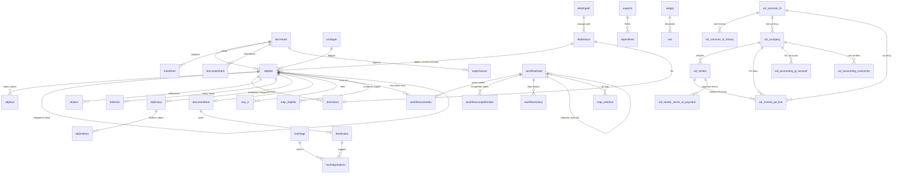

# Contelo — Database Schema Analysis & Smart Query Configuration

Generated: 2026-06-09 | PostgreSQL 14.1 @ 172.25.83.98:5432 | DB `Contelo` | **132 tables** (8 more than the prompt snapshot) | 0 declared FKs

Deliverables:
- **Smart Queries JSON**: `contelo_smart_queries.json` (132 entities, 59 SQL-validated relationships, 19 templates — every template executed successfully against the live DB)
- **Mermaid ER diagram**: `contelo-er.mmd` (also embedded in the JSON under `diagram.mermaid`)
- Validation tooling: `dump_schema.js`, `validate_relationships.js`, `test_templates.js`

---

## Step 1+2 — Relationship Map (SQL-validated)

Every candidate was checked with `LEFT JOIN` orphan counts. ELO convention: integer FK columns use `0` (or `-1` in workflow date fields) instead of NULL — validation treats those as "no value".

### ✓ Confirmed (59)

| # | Child table.FK | Parent table.PK | non-null | orphans | Status |
|---|----------------|-----------------|---------:|--------:|--------|
| 1 | objkeys.parentid | objekte.objid | 157 473 | 0 | ✓ confirmed |
| 2 | objekte.objparent | objekte.objid (self) | 29 072 | 0 | ✓ confirmed — repository tree |
| 3 | objekte.objmask | docmasks.maskno | 29 090 | 0 | ✓ confirmed |
| 4 | objekte.objtype | sordtype.id | 29 090 | 450 | ✓ confirmed* (1.5 % custom type ids 37–39 unregistered) |
| 5 | objekte.objdoc | elodmdocs.docid | 13 684 | 0 | ✓ confirmed (1:1, 0 = folder) |
| 6 | dochistory.objectid | objekte.objid | 14 769 | 0 | ✓ confirmed |
| 7 | dochistory.documentid | elodmdocs.docid | 14 769 | 0 | ✓ confirmed |
| 8 | elodmdocs.pathid | elodmpath.pathid | 14 770 | 0 | ✓ confirmed |
| 9 | relation.parentid | objekte.objid | 33 626 | 441 | ✓ confirmed* (1.3 % deleted parents) |
| 10 | relation.objectid | objekte.objid | 33 626 | 0 | ✓ confirmed |
| 11 | haftnotiz.parentid | objekte.objid | 8 | 0 | ✓ confirmed |
| 12 | objhistory.objguid | objekte.objguid | 15 415 | 0 | ✓ confirmed |
| 13 | objhistkeys.objhistguid | objhistory.objhistguid | 68 333 | 0 | ✓ confirmed |
| 14 | objreplsets.objid | objekte.objid | 174 | 0 | ✓ confirmed |
| 15 | documentfeed.objguid | objekte.objguid | 1 416 | 0 | ✓ confirmed (1:1) |
| 16 | feedaction.feedguid | documentfeed.feedguid | 2 373 | 0 | ✓ confirmed |
| 17 | feedaction.parentguid | feedaction.actionguid (self) | 1 | 0 | ✓ confirmed — replies |
| 18 | hashtagrelations.actionguid | feedaction.actionguid | 101 | 0 | ✓ confirmed |
| 19 | hashtagrelations.hashtagguid | hashtags.hstgguid | 101 | 0 | ✓ confirmed |
| 20 | masklines.maskno | docmasks.maskno | 1 959 | 0 | ✓ confirmed |
| 21 | docmaskinherit.parentmaskid | docmasks.maskno | 13 | 0 | ✓ confirmed |
| 22 | docmaskinherit.childmaskid | docmasks.maskno | 13 | 0 | ✓ confirmed |
| 23 | aspectassoc.maskid | docmasks.maskno | 23 | 0 | ✓ confirmed |
| 24 | aspectlines.aspectid | aspects.id | 22 | 0 | ✓ confirmed |
| 25 | aspectlines.swlgroupid | swlgrp.swlgroupid | 2 | 0 | ✓ confirmed |
| 26 | swl.groupid | swlgrp.swlgroupid | 446 | 0 | ✓ confirmed |
| 27 | asp_3.objid | objekte.objid | 312 | 0 | ✓ confirmed |
| 28 | asp_3.maskid | docmasks.maskno | 312 | 0 | ✓ confirmed |
| 29 | asp_4.objid | objekte.objid | 312 | 0 | ✓ confirmed |
| 30 | workflowactivedoc.wf_flowid | workflowhead.wfflowid | 1 553 | 0 | ✓ confirmed |
| 31 | workflowcompletiondoc.wf_flowid | workflowhead.wfflowid | 7 564 | 0 | ✓ confirmed |
| 32 | workflowhistory.wfguid | workflowhead.wfguid | 36 678 | 0 | ✓ confirmed |
| 33 | workflowactivedoc.wf_eloobjid | objekte.objid | 1 553 | 0 | ✓ confirmed |
| 34 | workflowcompletiondoc.wf_eloobjid | objekte.objid | 7 396 | 0 | ✓ confirmed |
| 35 | workflowhead.wfparent | workflowhead.wfflowid (self) | 2 463 | 0 | ✓ confirmed — sub-workflows |
| 36 | map_objekte.mapid→int | objekte.objid | 3 691 distinct | 0 | ✓ confirmed (varchar→int cast) |
| 37 | maphead_objekte.mapid→int | objekte.objid | 4 061 distinct | 0 | ✓ confirmed (cast) |
| 38 | map_wfactive.mapid→int | workflowhead.wfflowid | 21 distinct | 0 | ✓ confirmed (cast) |
| 39 | map_wffinished.mapid→int | workflowhead.wfflowid | 186 distinct | 0 | ✓ confirmed (cast) |
| 40 | sol_company.standard_currency_code | sol_common_fx.currency_code | 7 | 0 | ✓ confirmed |
| 41 | sol_common_fx_history.currency_code | sol_common_fx.currency_code | 197 625 | 0 | ✓ confirmed |
| 42 | sol_common_fx_history.base_currency_code | sol_common_fx.currency_code | 197 625 | 0 | ✓ confirmed |
| 43 | sol_vendor.company_code | sol_company.code | 72 | 1 | ✓ confirmed* (one stray company code) |
| 44 | sol_invoice_item.company_code | sol_company.code | 2 | 0 | ✓ confirmed |
| 45 | sol_invoice_po_line.company_code | sol_company.code | 63 | 0 | ✓ confirmed |
| 46 | sol_invoice_po_line.(company_code,vendor_no) | sol_vendor.(company_code,no) | 63 | 0 | ✓ confirmed — composite |
| 47 | sol_invoice_po_line.currency_code | sol_common_fx.currency_code | 63 | 0 | ✓ confirmed |
| 48–57 | sol_accounting_costcenter / costobject / gl_account, sol_business_area, sol_profit_center, sol_project, sol_internal_order, sol_wbs_element, sol_special_gl_indicator, sol_tax_code .company_code | sol_company.code | 2–18 each | 0 | ✓ confirmed (10 rels) |
| 58 | sol_vendor_terms_of_payment.company_code | sol_company.code | 3 | 0 | ✓ confirmed |
| 59 | sol_vendor_terms_of_payment.(company_code,vendor_no) | sol_vendor.(company_code,no) | 3 | 0 | ✓ confirmed — composite |

### ✗ Discarded (with reason)

| Candidate | non-null | orphans | Reason |
|-----------|---------:|--------:|--------|
| elodmdocpath.docid → elodmdocs | 0 | — | table empty |
| wiedervorlage.parentid → objekte | 0 | — | table empty |
| objlinks.objguidparent/target → objekte | 0 | — | table empty |
| feedactionhist.actionguid → feedaction | 0 | — | table empty |
| subscription.watchguid → objekte / documentfeed | 1 156 | 1 156 / 1 012 | watchguid = feed GUIDs, mostly of purged feeds (only 144 resolve) |
| notification.watchguid → objekte / documentfeed | 131 | 131 | no current target resolves |
| aspectassoc.aspectid → aspects | 22 | 16 | 73 % orphans — aspect definitions deleted |
| asphistory_3.objhistguid → objhistory | 1 094 | 782 | history kept longer than objhistory |
| workflowtempl.wf_flowid → workflowhead | 26 517 | 1 608 | 6 % orphans — deleted template heads |
| report.docid → objekte | 192 799 (sample) | 54 241 | 28 % orphans — audit log retains purged objects (by design; usable only as LEFT JOIN) |
| sol_invoice_item.vendor_no / gl_account_no / cost_center_no / cost_object_no | 2 | 2 | demo values don't match masters |
| sol_invoice_po_line.gl_account_no / cost_center_no / cost_object_no / item_no | 1–63 | 1–63 | values don't match masters |
| sol_vendor.country_code → sol_vat_rates.country | 81 | 22 | 27 % of countries missing in VAT table |
| sol_inbox_register.doctype_id → docmasks.maskno | 127 | 114 | ids reference masks of another system |

---

## Step 3 — Mermaid ER Diagram

Full diagram (all 132 tables, standalone ones included as single-attribute entities) is in **`contelo-er.mmd`** and in `diagram.mermaid` of the JSON. Core view:

---

## Step 5 — Domain Report

### Domain
**Contelo is the repository database of an ELO ECM (Enterprise Content Management / DMS) server**, ELO 20+ schema, used by a German-speaking organisation. On top of the core DMS it runs the **ELO Solutions accounting/invoice module** (`sol_*` tables, invoice workflows with PO matching) and small customisations (`Kundenakte` customer files, "Projektakte" translation keys).

### Key entities
- **objekte** (29 k) — every folder and document; tree via `objparent`, soft delete via `deletedate`, GUID for replication.
- **objkeys** (157 k) — the metadata: one row per filled index field per object; `docmasks`/`masklines` define which fields exist per document type (152 masks).
- **elodmdocs** + **dochistory** (≈15 k each) — physical files (size, MD5, extension, storage path) and the version history linking them to objects.
- **workflowhead / workflowactivedoc / workflowcompletiondoc / workflowhistory** — workflow engine: instance registry, active node states (bound to objects via `wf_eloobjid`), completed nodes, per-step audit.
- **documentfeed / feedaction / hashtags** — collaboration feed per object.
- **report** (41 M in production) — full audit log of every user/server action.
- **sol_company → sol_vendor → sol_invoice_po_line** — multi-company (8 companies) vendor and PO-line master data for invoice matching, with currency dictionary `sol_common_fx` and 197 k rows of FX history.

### Data flows
1. **Filing**: a document is stored → `elodmdocs` (file) + `objekte` (archive entry, mask) + `objkeys` (index values from `masklines` definitions) + `dochistory` (version link).
2. **Processing**: filing triggers a workflow → `workflowhead` instance, nodes appear in `workflowactivedoc` (bound to the object), finished nodes move to `workflowcompletiondoc`, each step logged in `workflowhistory`; form data is written to `map_objekte`/`map_wfactive` key-value maps.
3. **Invoice solution**: inbound invoices are matched against `sol_invoice_po_line` (vendor + PO + amounts) using `sol_company`, `sol_vendor`, `sol_common_fx` lookups.
4. **Collaboration & audit**: every object change writes `objhistory`/`objhistkeys` and `report`; users comment via `documentfeed`/`feedaction`.

### Patterns observed
- **No declared FKs at all** — integrity is enforced by the ELO server layer; integer "FKs" use `0`/`-1` as "no value".
- **History tables everywhere**: `objhistory`, `dochistory`, `asphistory_N`, `maph_*`, `feedactionhist`, `workflowhistory`, `sol_common_fx_history`.
- **Soft delete**: `objekte.deletedate ≠ 0` (200+ rows), final purge queue `physdel` (575 k).
- **Key-value maps**: `map_*`/`maphead_*` per domain (`mapdomain` dictionary) with `mapid` = object/workflow id stored as varchar.
- **Translation table** `translations` (lang1–lang23 per `trankey`) for mask/workflow labels.
- **Multi-tenancy light**: `sol_*` tables keyed by `company_code` (8 companies).

### Data quality notes
- `report.docid`: 28 % of sampled rows point to purged objects — join only with LEFT JOIN.
- `subscription`/`notification.watchguid`: 87–100 % point to no existing feed (purged feeds kept as subscriptions).
- `aspectassoc.aspectid`: 16 of 22 rows reference deleted aspects.
- `workflowtempl`: 6 % of nodes orphaned from `workflowhead`.
- `sol_invoice_item` and parts of `sol_invoice_po_line` carry demo data that doesn't match the cost-center/G-L masters.
- ~35 tables are completely empty (objlinks, wiedervorlage, eloft*, kom*, etc.).
